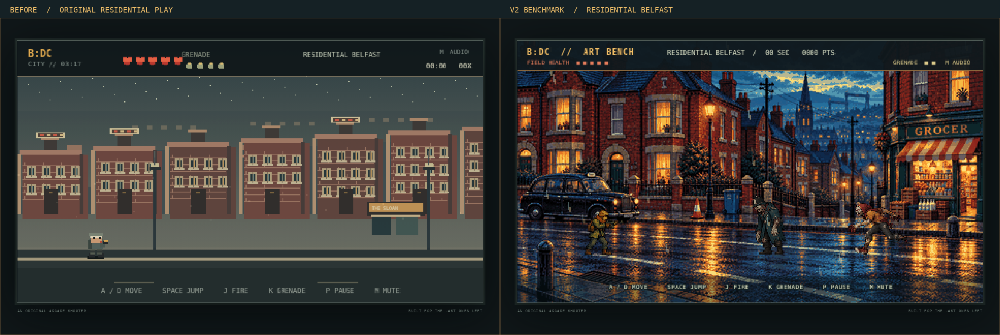
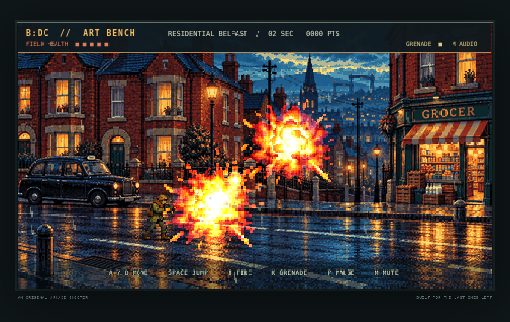
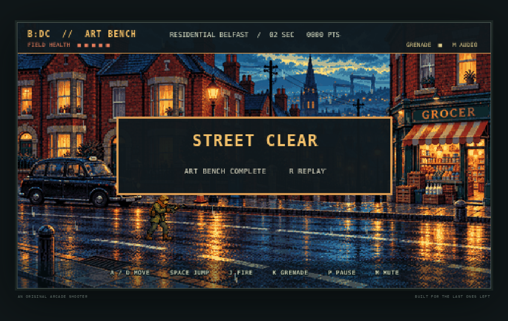

# BELFAST: DEAD CITY

A standalone pixel-art run-and-gun about a night journey through a zombie-overrun Belfast. It is made with Phaser 3, TypeScript, and Vite, with original procedurally painted scene and sprite textures.

## Play locally

```sh
npm ci
npm run dev
```

Open the local URL printed by Vite. The title screen starts with **Enter** or **Space**.

| Key | Action |
| --- | --- |
| A / D | Move left and right |
| Space / W | Jump |
| J | Fire |
| K | Throw a grenade |
| P / Esc | Pause or resume |
| M | Mute or unmute synthesized effects |
| Enter | Start or restart |

The single continuous route moves from residential terraces, through the city centre, and into a City Hall finale. Shambler, runner, and spitter encounters precede a two phase boss fight. Grenades are limited; defeated enemies occasionally drop a grenade. The game can be restarted after victory or defeat.

## Visual benchmark V2

The playable one-screen art benchmark is available at `/?benchmark=1`. It uses an original Belfast terrace and corner shop scene, an eight-pose survivor, four shambler poses, four runner poses, an eight-frame explosion, animated rain, shop glow, drain steam, and hit and death particles. The benchmark is intentionally separate from the main level pending visual review.

```sh
npm run dev
# Open the Vite URL with ?benchmark=1
npm run record:benchmark
```

The generated source atlases and reduced runtime frames are under `src/assets/`: eight player poses, four frames for each of two zombie archetypes, and eight explosion frames. Sources are original to this project and were reduced to hard-pixel PNG frames. Benchmark screenshots and footage are linked below. Existing main-level gameplay and art remain unchanged at this checkpoint.

Current benchmark limits: it is a fixed one-screen street with a richly layered painted backdrop, atmospheric animation, and no camera parallax. The City Hall, spitter and boss artwork have not been converted. The final explosion frame is intentionally bright and briefly obscures nearby sprites.

## Build and verify

```sh
npm ci
npm test
npm run build
npm run preview
```

The static build is written to `dist/`. `npm run build` runs the TypeScript project check before creating the production site. The GitHub Actions verification workflow runs the unit checks and Playwright smoke test, then stores `dist` as an artifact; it does not publish or deploy.

## Gameplay recording

Run `npm run record` to build the production site and record a keyboard driven Chromium session to `artifacts/gameplay-run.webm`. The checked in recording covers the residential route, city centre, and City Hall boss arrival; this run ends in defeat during phase one, so it does not show the victory sequence.

## GitHub Pages

The Vite build uses relative asset paths and can be hosted beneath the repository path. To publish after reviewing the build:

1. Open repository **Settings → Pages** and set the source to **GitHub Actions**.
2. Push the desired source to `main` and wait for **Verify game** to pass.
3. Open the **Actions** tab, select **Deploy to GitHub Pages**, and click **Run workflow** on `main`.

The deploy workflow runs only when manually dispatched; pushes run verification without publishing. I have not dispatched the deploy workflow.

## Visual evidence


[Watch the gameplay recording](artifacts/gameplay-run.webm)

### Before and benchmark







[Watch V2 benchmark gameplay](artifacts/benchmark-gameplay.webm)

## Notes

- Art and sound are drawn or synthesized by the game itself; there are no downloaded game assets.
- The display uses a 480 × 270 logical canvas, fitted to the browser with nearest-neighbor scaling.
- Recommended baseline: a current desktop Chromium, Firefox, or Safari browser with keyboard input.
