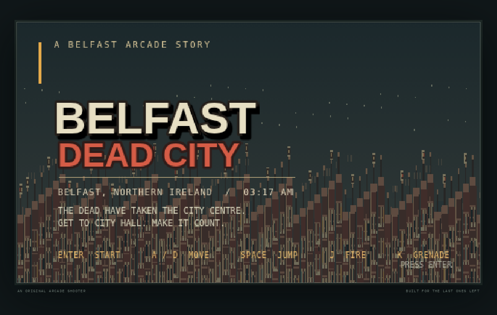
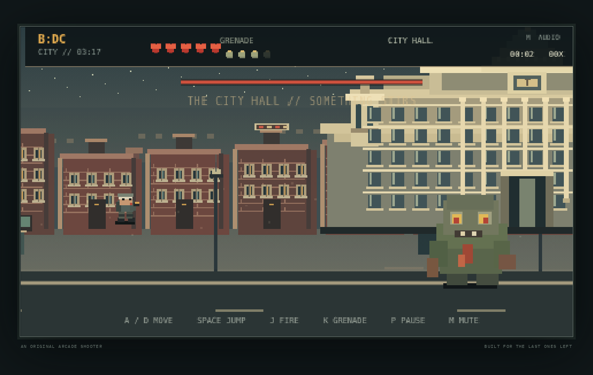
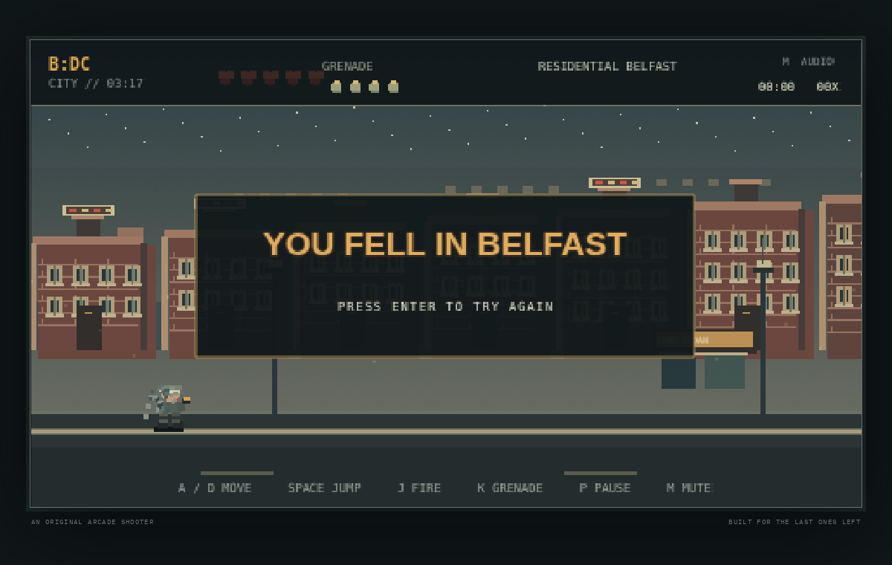
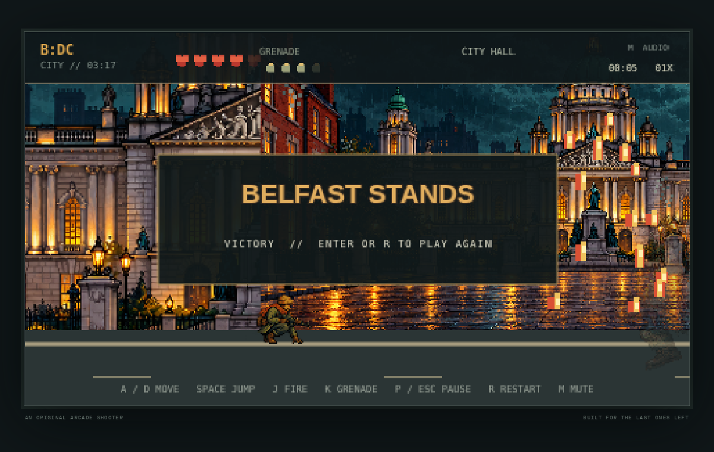

# BELFAST: DEAD CITY

A standalone pixel-art run-and-gun about a night journey through a zombie-overrun Belfast. It is made with Phaser 3, TypeScript, and Vite, with original procedurally painted scene and sprite textures.

## Play locally

```sh
npm ci
npm run dev
```

Open the local URL printed by Vite. The title screen starts with **Enter** or **Space**.

| Key | Action |
| --- | --- |
| A / D | Move left and right |
| Space / W | Jump |
| J | Fire |
| K | Throw a grenade |
| P / Esc | Pause or resume |
| M | Mute or unmute synthesized effects |
| Enter | Start or restart |

The single continuous route moves from residential terraces, through the city centre, and into a City Hall finale. Shambler, runner, and spitter encounters precede a two phase boss fight. Grenades are limited; defeated enemies occasionally drop a grenade. The game can be restarted after victory or defeat.

## Build and verify

```sh
npm ci
npm test
npm run build
npm run preview
npm run test:physics
```

The static build is written to `dist/`. `npm run build` runs the TypeScript project check before creating the production site. The GitHub Actions verification workflow runs unit checks, the Playwright smoke test, and the V6 physics benchmark, then stores the build and benchmark artifacts; it does not publish or deploy.

`npm run test:physics` runs a keyboard-controlled Playwright benchmark against the production build. It checks movement, jump buffering and coyote time, car and shelter traversal, obstacle movement, damage cooldown, camera scrolling, and Arcade Physics at 30 and 120 Hz. Screenshots, measurements, and a WebM recording are written to `artifacts/v6/`.

## Gameplay recording

Run `npm run record` to build the production site and record a keyboard driven Chromium session to `artifacts/gameplay-run.webm`. The checked in recording covers the residential route, city centre, and City Hall boss arrival; this run ends in defeat during phase one, so it does not show the victory sequence.

## GitHub Pages

The Vite build uses relative asset paths and can be hosted beneath the repository path. To publish after reviewing the build:

1. Open repository **Settings → Pages** and set the source to **GitHub Actions**.
2. Push the desired source to `main` and wait for **Verify game** to pass.
3. Open the **Actions** tab, select **Deploy to GitHub Pages**, and click **Run workflow** on `main`.

The deploy workflow runs only when manually dispatched; pushes run verification without publishing. I have not dispatched the deploy workflow.

## Visual evidence









[Watch the gameplay recording](artifacts/gameplay-run.webm)

[Watch the V6 keyboard physics benchmark](artifacts/v6/keyboard-benchmark.webm)

[View V6 physics measurements and limitations](docs/v6-physics-benchmark.md)

## Notes

- Art and sound are drawn or synthesized by the game itself; there are no downloaded game assets.
- The display uses a 480 × 270 logical canvas, fitted to the browser with nearest-neighbor scaling.
- Recommended baseline: a current desktop Chromium, Firefox, or Safari browser with keyboard input.
