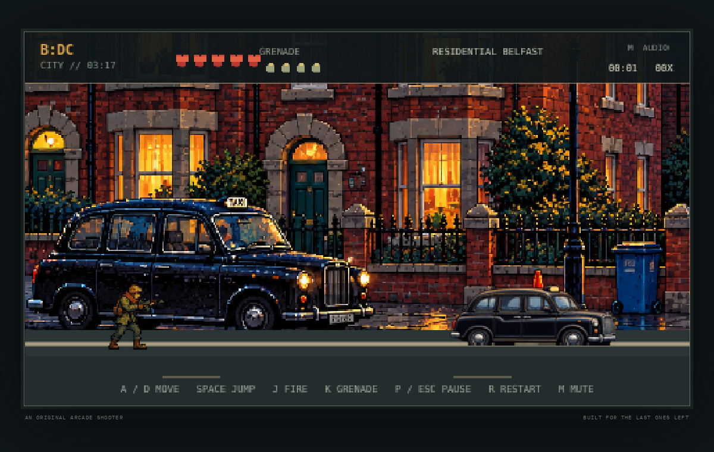
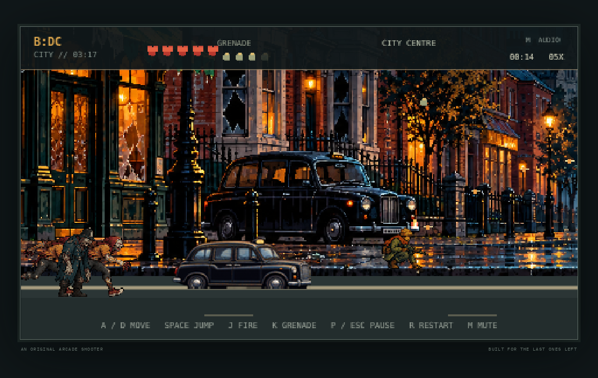
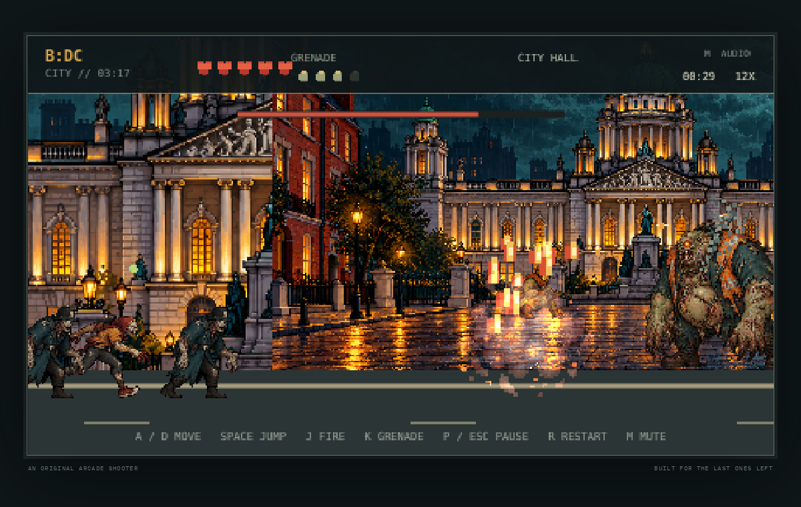
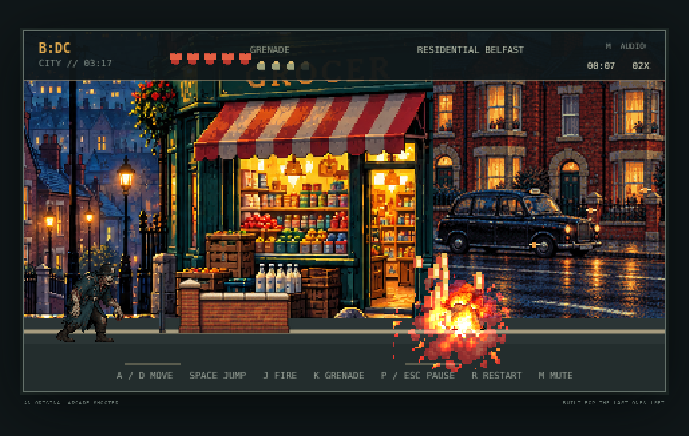
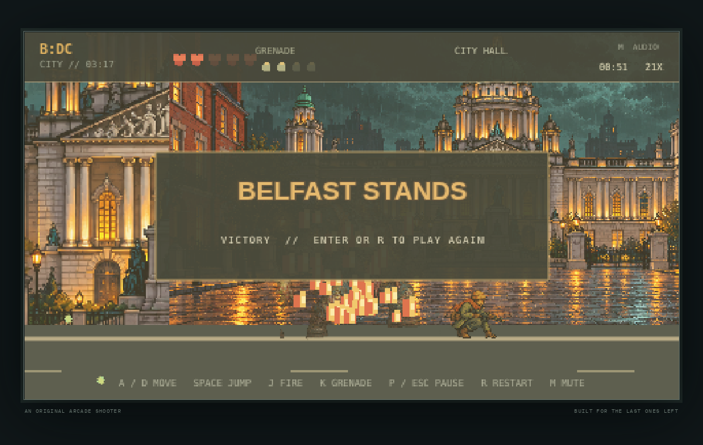

# BELFAST: DEAD CITY

A keyboard-first arcade run-and-gun through a zombie outbreak in Belfast. Built with Phaser 3, TypeScript and Vite. Artwork and sound are original project assets or synthesized at runtime; play requires no account or online service.

## Play locally

```sh
npm ci
npm run dev
```

Open the local Vite URL. Press **Enter** or **Space** at the title screen.

| Key | Action |
| --- | --- |
| A / D | Move |
| Space / W | Jump |
| J | Fire |
| K | Throw a grenade |
| P / Esc | Pause or resume |
| M | Mute or unmute synthesized effects |
| Enter / R | Start, restart, or replay |

The single route travels through residential terraces, the city centre, and a City Hall-inspired finale. Its three enemy types are shamblers, runners, and spitters. A two-phase boss closes the route. Low street structures provide optional jump-up fighting positions; a checkpoint near City Hall restores up to two health hearts.

## V3 gameplay and visual work

- Added taxi, brick-wall, and bus-shelter platforms with top-only collision; buffered jumps, coyote time, landing feedback, and enemy jumps toward elevated players.
- Improved enemy telegraphs and reactions, grenade bounce, blast damage and knockback, boss phases, camera feedback, pause, and restart. Fixed projectile collision handling that could remove the player body.
- Integrated original Belfast residential, city-centre, and City Hall arcade backdrops; added a four-pose boss, and detailed original taxi, bus-shelter and brick-wall platform sprites. The V2 benchmark remains at `/?benchmark=1`.
- Player, two common zombie types, and explosion use the V2 frame sets. Spitter still uses a simpler locally drawn sprite treatment, and some street trim and impact particles are less detailed than the painted scene art; the visual style is not fully uniform.

Main-level art files are in `src/assets/`. This includes eight player poses, four shambler poses and four runner poses (from an eight-frame zombie set), an eight-frame explosion, four original boss poses, a platform prop atlas and three extracted platform sprites, and Belfast backdrop source illustrations with reduced game panels. Original source illustrations are kept beside their reduced game panels for inspection. The backgrounds are detailed pixel-treated illustrations; characters and some props have a coarser, smaller pixel scale.

## Verify and record

```sh
npm test
npm run test:browser
npm run record
npm run record:benchmark
```

`npm run test:browser` builds the production site and runs Chromium integration and benchmark smoke tests. The gameplay recorder uses keyboard inputs in headless Chromium and saves a WebM plus stage captures under `artifacts/`. Its test helpers can inspect scene state; the attached full-run video itself uses ordinary controls and does not change game state.

The recorded V3 keyboard run reached the City Hall boss and the victory screen without state manipulation. It lasted 54.04 seconds of video (52 seconds on the in-game timer), so it verifies a complete route but **does not meet the desired 8–12 minute playthrough target**. The automated boss smoke test separately forces phase transitions and victory to verify restart and flow; this is not counted as natural completion evidence.

## Evidence

V3 screenshots from the recorded keyboard run:











[Watch the complete keyboard playthrough](artifacts/v3-full-playthrough.webm)

The older V2 benchmark evidence is retained separately as `benchmark-street.png`, `benchmark-combat.png`, and `benchmark-gameplay.webm` under `artifacts/`.

## V4 environment and encounter work

- Replaced the flat ground slab with a single pixel-scale street plate spanning the 4,980 px route. It carries the same stone footpath and kerb across all areas, with subdued aggregate, worn lane paint, drains, cracked repairs, wet patches, and two side-street crossings. The residential, centre, and City Hall backdrops are assembled into one panorama with narrow local fades at panel joins; wet playable-road artwork stays continuous underneath.
- The six taxi, shelter, and low-wall platforms keep top-only collision. Their stored collision tops match the visible roof tops and the collision width is inset 7 px per side. Players can land, jump through from below, jump away, and return. Nearby enemies can jump onto elevated positions. Enemies more than 460 px behind the player are recycled so they cannot attack off-screen or exhaust the spawn pool.
- Reworked the authored encounter schedule into 13 deterministic mixed groups and expanded the reusable enemy pool. Most groups appear ahead of the player, with occasional rear pressure. A health pickup at the City Centre to City Hall transition restores up to two hearts; the final approach restores up to three.
- Add `?debug=1` to the game URL and press **F2** for collision outlines; the blue line marks the ground plane, gold marks platforms, and colored boxes mark actors and projectiles.
- Added browser assertions for the 4,980 px road and backdrop coverage, platform artwork/body alignment and one-way collision flags, mixed enemy composition, behind-camera recycling, landing, jumping through the underside, and enemies reaching a platform.

V4 evidence (the V3 screenshot is the matching pre-overhaul comparison):

| Location | Before | V4 |
| --- | --- | --- |
| Residential street | [V3 residential](artifacts/v3-residential.png) | [V4 road and terrace](artifacts/v4-residential-road.png) |
| Cross-street | — | [Residential junction](artifacts/v4-residential-junction.png) |
| City-centre combat | [V3 city centre](artifacts/v3-city-centre.png) | [V4 city centre](artifacts/v4-city-centre.png) |
| Mixed encounter | — | [Mixed zombies](artifacts/v4-mixed-encounter.png) |
| City Hall transition | — | [City Hall approach](artifacts/v4-city-hall-approach.png) |
| Collision geometry | — | [Debug overlay](artifacts/v4-collision-debug.png) |
| Finale | [V3 boss](artifacts/v3-city-hall-boss.png) | [V4 boss](artifacts/v4-city-hall-boss.png) |
| Victory | [V3 victory](artifacts/v3-victory.png) | [V4 victory](artifacts/v4-victory.png) |

[Watch the natural keyboard-controlled V4 run](artifacts/v4-full-playthrough.webm) · [Read its route and FPS trace](artifacts/v4-playthrough.json)

The V4 recording was 54.52 seconds of video (51.25 seconds on the game clock), ended in victory with 3 health remaining, and recorded 27 kills. It used only keyboard controls: Enter, movement, fire, timed jumps, grenades, and boss evasions; the recording did not change game state. It demonstrates a full natural win, **not** the requested 8–12-minute playthrough target. The run trace sampled 50–60 FPS in headless Chromium 156 on the Linux cloud runner at 1200 × 760; this is not a sustained physical-desktop measurement.

`npm run test:browser` builds production and runs the browser smoke suite. It also overwrites some legacy generic smoke screenshots in `artifacts/`; the named V3 and V4 evidence files above are separate.

## Build and GitHub Pages

```sh
npm ci
npm run build
npm run preview
```

The static build is written to `dist/`, and Vite uses relative asset paths for repository-path hosting. The GitHub Actions verification workflow runs unit and browser checks and uploads the built site as an artifact. The repository also contains a manually dispatched Pages deployment workflow. Set the repository Pages source to **GitHub Actions**, then run that deployment workflow on the reviewed source branch to publish. No deployment has been performed for V3.

## Performance notes

Sampling was done in headless Chromium 156 on the Linux cloud runner at a 1200 × 760 viewport. The main-game smoke test sampled 59.1 FPS early in play, the natural recorded run sampled roughly 55–60 FPS, and the warmed benchmark sampled 60.25 FPS. This is not a sustained physical-desktop benchmark, and stable 60 FPS is not claimed.
